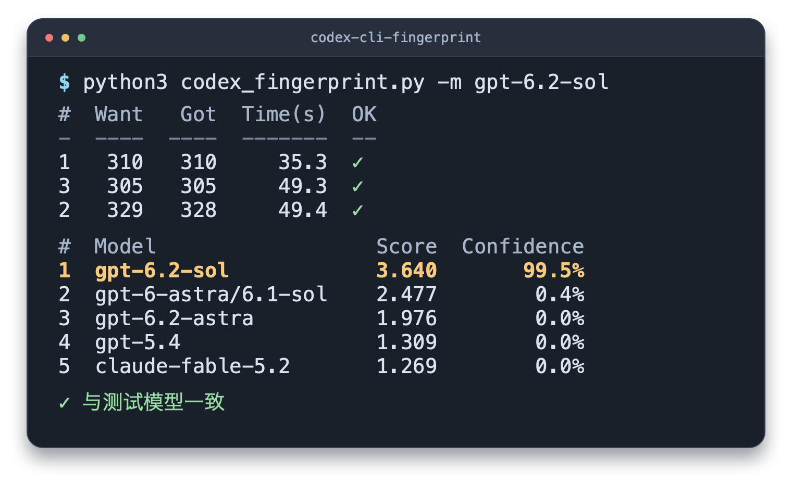

# Codex CLI 指纹检测

检测本地 Codex CLI 实际调用的 GPT 模型。脚本让模型凭第一反应写出约 300 个 1–355 的整数，再与参考库比对。当前参考库包含 72 个指纹类别，其中包括 GPT‑6.2 Sol 和 Astra。脚本只使用 Python 3 标准库。指纹数据和检测算法来自 [lm-detector](https://github.com/Ikaleio/lm-detector/tree/33fb43f26670be0ed7817ab13e5c4c4731ccb76a)。



## 用法

需要先安装 [Codex CLI](https://github.com/openai/codex)。

```bash
python3 codex_fingerprint.py -m gpt-6.2-sol
```

### 一键运行

以下任选其一，指纹数据会从本仓库下载：

```bash
curl -fsSL https://is.gd/codex_fingerprint | python3 - -m gpt-6.2-sol
```

```bash
wget -qO- https://is.gd/codex_fingerprint | python3 - -m gpt-6.2-sol
```

参数：

- `-m, --model`：要测试的 Codex 模型名（必填）
- `-r, --reasoning-effort`：推理强度，默认 `low`，与参考库中 GPT 样本的采集条件一致

每次运行并行发送 3 个挑战。脚本在整个参考库中评分，列出排名最高的 5 个 GPT 候选，并用全库第一名判断是否与测试模型一致。3 条回答均有效且校准参数与检测器匹配时，才显示置信度。置信度是参考库内的闭集概率，库外模型也会匹配到库内最接近的候选。

## 致谢

- [lm-detector](https://github.com/Ikaleio/lm-detector) 提供指纹数据和检测算法，见 [MIT 许可](LICENSE.lm-detector)
- [LINUX DO](https://linux.do/) - 新的理想型社区
