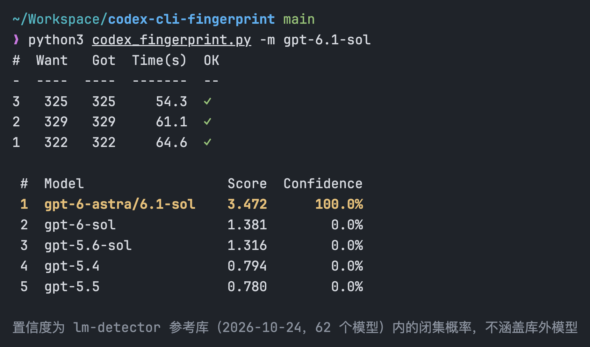

# Codex CLI 指纹检测

检测本地 Codex CLI 实际调用的是哪个 GPT 模型。脚本让模型凭第一反应写出约 300 个 1–355 的整数，将数字分布与 [lm-detector](https://github.com/Ikaleio/lm-detector) 参考库比对。指纹数据与算法均来自 lm-detector，只需系统自带的 python3，无需安装依赖。



## 用法

需要先安装 [Codex CLI](https://github.com/openai/codex)。

```bash
python3 codex_fingerprint.py -m gpt-6.1-sol
```

### 一键运行

以下任选其一，指纹数据会从本仓库下载：

```bash
curl -fsSL https://is.gd/codex_fingerprint | python3 - -m gpt-6.1-sol
```

```bash
wget -qO- https://is.gd/codex_fingerprint | python3 - -m gpt-6.1-sol
```

参数：

- `-m, --model`：要测试的 Codex 模型名（必填）
- `-r, --reasoning-effort`：推理强度，默认 `low`，与参考库中 GPT 样本的采集条件一致

每次运行并行发送 3 个挑战，最后判断排名第一的模型是否与测试模型一致。3 条回答均有效时才计算置信度。置信度是参考库内的闭集概率，库外模型也会匹配到最接近的候选，结果仅供参考。

## 致谢

- [lm-detector](https://github.com/Ikaleio/lm-detector) - 指纹数据与检测算法
- [LINUX DO](https://linux.do/) - 新的理想型社区
